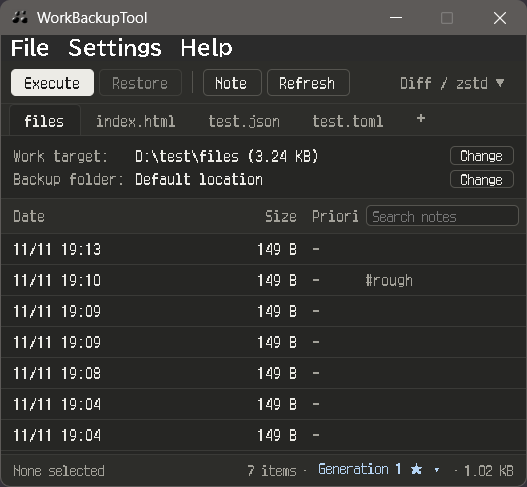
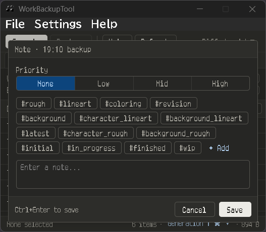
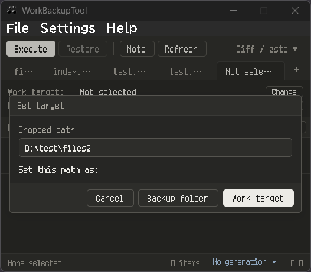
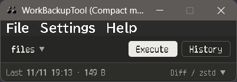
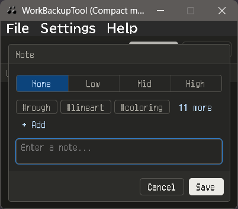
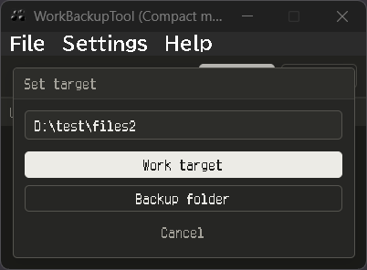

# WorkBackupTool

A simple, lightweight backup utility built with Tauri (Rust), specifically designed for managing 2DCG project files and work-in-progress versions.

This tool was created by the author for personal use to ensure quick and reliable versioning during creative workflows.

## 📸 Screenshots

### Main Window



*Standard view with full backup controls and history list.*



*Note panel: attach memos with priority marks and preset tags to any backup entry.*



*Drag & drop a file or folder directly onto the window to set it as the backup target.*

### Compact Window



*Compact mode for minimal screen footprint during active work.*



*Note panel in compact mode.*



*Drag & drop support in compact mode.*

---

## 🔎 Key Features

- **Streamlined UI**: A single-window interface focused on "Backup" and "Restore."
- **Backup Modes**:
  - **Full Copy**: Creates a standard copy of the selected file or folder.
  - **Archive**: Compresses data into ZIP or TAR.GZ formats with optional password protection.
  - **Differential (Smart)**: Saves disk space by storing binary differences using HDiffPatch. Supports both single files and folders, with configurable Zstandard, LZMA2, or no compression.
- **Generation Management**: Organizes differential backups into generations. Each generation consists of a full base copy and subsequent diff files. A new generation is automatically created when the cumulative size of its diff files exceeds a configurable multiple of the base size.
- **Configurable Generation Threshold**: Controls when a new generation is created. The default is 1.0, meaning that a new generation is created when the cumulative diff size exceeds the base size. The configurable range is 0.1–3.0.
- **Per-Tab Ignore List**: Specify file patterns (e.g. `*.tmp`) to exclude from differential backups, configured independently for each project tab.
- **Note System**: Attach memos with priority marks and preset tags to any backup entry.
- **Quick Restore**: Browse backup history and restore a selected version.
- **Tab Management**: Manage multiple projects simultaneously in a single window.
- **Compact & Tray Mode**: Switch to a minimal window or minimize the application to the system tray for unobtrusive background operation.
- **Multi-language**: English and Japanese support.

## ✅ Implementation Status

### Core Backup Functions

- **Full Copy**: Simple duplication of workspace files or folders.
- **Archive**: ZIP and TAR.GZ formats with optional password protection.
- **Differential (HDiffPatch)**: Supports Zstandard, LZMA2, and no compression. Supports both single files and folders.
- **Generation Management**: Automatic base rotation based on the cumulative size of diff files relative to the base size.
- **Configurable Generation Threshold**: Default 1.0, configurable from 0.1 to 3.0.
- **Per-Tab Ignore List**: Exclude files by pattern (e.g. `*.tmp`) from differential backups. Settings are stored per tab in `session.json`.

### User Interface (UI/UX)

- **Tab Management**: Multiple project tabs with reordering and right-click context menus.
- **Backup History**: Browse backup history with metadata popups (path, note, priority, and generation information).
- **Note System**: Memos with priority marks (None / Low / Mid / High) and preset tags, stored as `.note` files.
- **Search & Filter**: Filter backup history by filename or note content.
- **Compact Mode**: Minimal window size for unobtrusive use during work.
- **Tray Mode**: Minimize to the system tray with quick-execute support.
- **Window Options**: Always on Top and Restore Previous State.
- **Multi-language**: English and Japanese.
- **Advanced Settings**: Schema-driven settings panel with categorized pages.
- **Strict Hash Check**: Optional `-C-all` flag for full checksum verification during restore. Note that this increases diff file size.

## 🗂 Generation Structure

Differential backups are organized into **generations**.

Each generation is a folder containing one full base copy and zero or more diff files.

The base copy can be either a file or a directory, depending on the backup target.

### Folder Backup Example

When the backup target is a folder, the `.base` entry is a directory containing a full copy of the target folder.

```text
wbt_backup_my_project/
└── base1_20260101_120000/          ← Generation folder
    ├── my_project.base/             ← Full base directory
    │   ├── project.clip
    │   ├── textures/
    │   │   ├── texture01.png
    │   │   └── texture02.png
    │   └── materials/
    │       └── material01.mat
    ├── my_project.20260101_120500.hdiff.diff
    ├── my_project.20260101_130000.hdiff.diff
    └── my_project.20260101_150000.hdiff.diff
```

### Single File Backup Example

When the backup target is a single file, the `.base` entry is a file containing a full copy of the target file.

```text
wbt_backup_my_project/
└── base1_20260101_120000/          ← Generation folder
    ├── illustration.base            ← Full base file
    ├── illustration.20260101_120500.hdiff.diff
    ├── illustration.20260101_130000.hdiff.diff
    └── illustration.20260101_150000.hdiff.diff
```

### Base

The `.base` entry is a full copy of the target file or folder at the time the generation was created.

It serves as the reference point for all diff files within that generation.

- For folder backups, the `.base` entry is a directory.
- For single-file backups, the `.base` entry is a file.

### Diff Files

Each differential backup produces a diff file representing the difference between the generation's base and the target's state at that backup point.

Diff files are generated against the same base, not against the previous diff.

This means that each diff file represents an independently restorable version within its generation.

### Generation Rotation

A new generation is created automatically when the cumulative size of its diff files exceeds the configured threshold relative to the base size.

The calculation is:

```text
diff_ratio = cumulative_diff_size / base_size

Create a new generation when:

cumulative_diff_size > base_size × threshold
```

Where:

- `base_size` is the size of the full base copy in the current generation.
- `cumulative_diff_size` is the sum of the sizes of all diff files belonging to the current generation and backup target.
- `threshold` is the configurable generation threshold.

The default threshold is **1.0** (100%).

The configurable range is **0.1–3.0** (10%–300%).

For example, with a base size of 1 GB and the default threshold of 1.0:

- 300 MB of cumulative diffs: Continue using the current generation.
- 800 MB of cumulative diffs: Continue using the current generation.
- 1.1 GB of cumulative diffs: Create a new generation.

When the threshold is exceeded:

1. A new generation folder is created.
2. A fresh full base copy is made from the current state of the target.
3. New diff files start accumulating in the new generation.

The previous generation remains available for restoring earlier versions.

**Note:** Targets with a base size of 100 KB or less are excluded from automatic generation rotation.

### Restore

Each diff file can be applied independently to its corresponding base to reconstruct the target state at the time that diff was created.

Restore uses the base and the selected diff file from the same generation.

This design allows any recorded version within a generation to be restored without applying intermediate diff files.

## 🚀 How to Use

1. **Target**: Select the file or folder you want to back up.
2. **Location**: Set the destination folder, or use the default location.
3. **Execute**: Choose your backup mode and click "Execute."
4. **Restore**: Select a previous version from the history list and click "Restore to selected point."

## ⚙️ Settings

### Generation Threshold

The generation threshold determines how much cumulative diff data can accumulate before a new base generation is created.

- **Default**: `1.0`
- **Minimum**: `0.1`
- **Maximum**: `3.0`

The threshold is a multiplier of the base size.

| Threshold | Meaning |
| --------- | --------------------------------------------------------- |
| 0.5       | Rotate when cumulative diffs exceed 50% of the base size  |
| 1.0       | Rotate when cumulative diffs exceed 100% of the base size |
| 1.5       | Rotate when cumulative diffs exceed 150% of the base size |
| 2.0       | Rotate when cumulative diffs exceed 200% of the base size |
| 3.0       | Rotate when cumulative diffs exceed 300% of the base size |

A lower threshold creates new base generations more frequently, while a higher threshold allows more diff files to accumulate before creating a new base.

The default value of 1.0 provides a balance between the storage used by accumulated diffs and the frequency of creating full base copies.

## 🛠 For Developers

This application is built using [Tauri](https://github.com/tauri-apps/tauri).

### Prerequisites

- Rust
- Node.js
- Tauri CLI

### Commands

Run in development mode:

```bash
npm run tauri:dev
```

Build the application:

```bash
npm run tauri:build
```

### External Binaries

This tool uses [HDiffPatch](https://github.com/sisong/HDiffPatch) for differential backup and restore.

The binaries are bundled as Tauri sidecar executables located in `src-tauri/binaries/` and are automatically placed alongside the application executable upon installation.

## 📦 Distribution Notes

- **Licenses**: This software uses several open-source libraries. See `CREDITS.md` for the list of dependencies and the `licenses/` directory for their full license texts.

## License

This project is licensed under the MIT License. See [LICENSE.md](LICENSE.md) for details.

Copyright (c) 2024-2026 m0090-dev

For a complete list of third-party licenses and credits, please refer to `CREDITS.md`.
